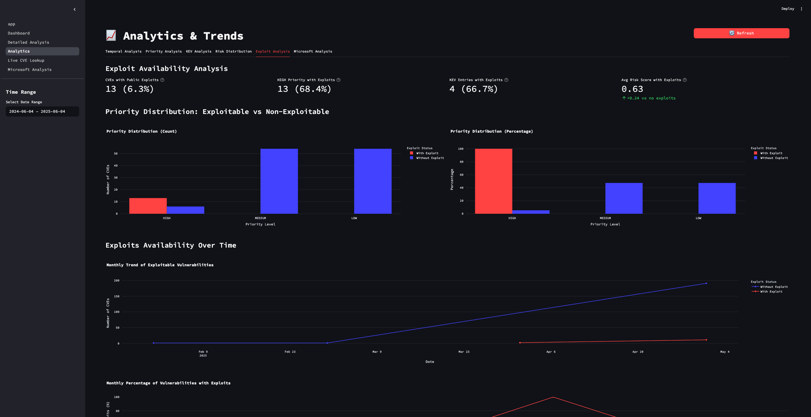

# VIPER - Vulnerability Intelligence, Prioritization, and Exploitation Reporter

## Overview

VIPER is an AI-powered cybersecurity platform designed to automate vulnerability intelligence, risk assessment, prioritization, and reporting.

The platform collects vulnerability data from multiple trusted sources, including NVD, EPSS, CISA KEV, and Microsoft Security Updates. It uses artificial intelligence to analyze security threats, evaluate potential risks, and provide actionable insights.

VIPER provides multiple interfaces, including an interactive Streamlit dashboard, a command-line interface (CLI), and Model Context Protocol (MCP) integration for natural language vulnerability analysis.

## Key Features

- **Vulnerability Intelligence:** Collect and consolidate vulnerability information from multiple security databases.
- **AI-Powered Analysis:** Analyze vulnerabilities using Google Gemini, OpenAI GPT, or local language models.
- **Risk Assessment:** Calculate vulnerability risk using a weighted, multi-factor scoring system.
- **Real-Time CVE Lookup:** Retrieve and analyze vulnerability information on demand.
- **Vulnerability Prioritization:** Identify critical security threats based on severity and exploitation probability.
- **Interactive Dashboard:** Visualize vulnerability data, risk scores, statistics, and security trends.
- **MCP Integration:** Enable natural language interactions with cybersecurity analysis tools.
- **Local AI Support:** Perform private vulnerability analysis using locally hosted language models.
- **Docker Support:** Simplify application deployment and environment configuration.
- **Database Management:** Store and manage vulnerability intelligence for future analysis.

## Technology Stack

| Category | Technologies |
|---|---|
| Programming Language | Python |
| Frontend | Streamlit |
| Artificial Intelligence | Google Gemini, OpenAI GPT |
| Local Language Models | Ollama, Llama, Mistral, Code Llama |
| AI Integration | Model Context Protocol (MCP) |
| Database | SQLite |
| Containerization | Docker, Docker Compose |
| Data Sources | NVD, EPSS, CISA KEV, Microsoft |
| API Integration | REST APIs |
| Reliability | Tenacity |

## System Architecture

The platform consists of five main components:

### 1. Data Collection

Collects vulnerability information from external cybersecurity databases and security intelligence feeds.

### 2. Data Processing

Processes and enriches vulnerability information, including severity scores, exploitation probabilities, affected products, and known security risks.

### 3. AI Analysis

Uses configurable language models to perform contextual vulnerability analysis, generate summaries, and provide security recommendations.

### 4. Risk Assessment

Evaluates vulnerability severity and exploitation likelihood using a weighted risk-scoring mechanism.

### 5. Presentation Layer

Provides access to vulnerability intelligence through an interactive dashboard, command-line interface, and MCP-compatible AI applications.

## MCP Integration

VIPER includes a Model Context Protocol server that enables AI assistants to interact with cybersecurity analysis tools using natural language.

Supported capabilities include:

- Real-time CVE analysis
- NVD vulnerability information retrieval
- EPSS exploitation probability assessment
- CISA KEV status verification
- Public exploit information lookup
- AI-powered vulnerability analysis
- Vulnerability risk scoring
- Database storage and management

## Installation

### Prerequisites

- Python
- Git
- Docker and Docker Compose (optional)
- API credentials for cloud-based AI providers
- Ollama for local AI analysis (optional)

### Environment Setup

Navigate to the project directory and run the setup script:

```bash
cd viper
./setup.sh
```

Create the environment configuration file:

```bash
cp env.example .env
```

Configure the preferred AI provider in the `.env` file.

## AI Provider Configuration

VIPER supports multiple AI providers, allowing users to choose between cloud-based and locally hosted language models.

### Google Gemini

```env
LLM_PROVIDER=gemini
GEMINI_API_KEY=your_api_key
```

### OpenAI

```env
LLM_PROVIDER=openai
OPENAI_API_KEY=your_api_key
OPENAI_MODEL_NAME=gpt-4o-mini
```

### Local LLM with Ollama

```env
LLM_PROVIDER=ollama
OLLAMA_API_BASE_URL=http://localhost:11434
LOCAL_LLM_MODEL_NAME=llama3:8b
```

Supported local models include:

- Llama 3 8B
- Llama 3 70B
- Code Llama 7B
- Mistral 7B

Local language models allow AI analysis without sending vulnerability information to external AI providers.

## Running the Application

### Interactive Dashboard

```bash
python main.py dashboard
```

The dashboard provides access to:

- Vulnerability overview
- Detailed vulnerability analysis
- Real-time CVE lookup
- Risk assessment
- Security analytics
- Vulnerability trends
- Data filtering and sorting

### Command-Line Interface

```bash
python main.py cli --days 7
```

The CLI enables vulnerability data collection and analysis directly from the terminal.

### Docker Deployment

```bash
docker-compose up -d
```

To initialize a local AI model:

```bash
docker exec -it viper_ollama ollama pull llama3:8b
```

The dashboard can be accessed at:

```text
http://localhost:8501
```

## MCP Server Configuration

Configure an MCP-compatible AI application using the following configuration:

```json
{
  "mcpServers": {
    "ViperMCPServer": {
      "command": "/FULL/PATH/TO/viper/run_mcp_clean.sh"
    }
  }
}
```

This integration enables natural language vulnerability analysis and access to the platform's cybersecurity tools.

## Screenshots

### Main Dashboard


### Detailed Vulnerability Analysis


### Real-Time CVE Lookup


### Analytics and Trends



## Security and Privacy

VIPER supports privacy-focused vulnerability analysis through locally hosted language models.

Security and reliability considerations include:

- Configurable AI providers
- Environment-based API credential management
- Local AI processing
- External API retry mechanisms
- Centralized vulnerability data storage
- Multi-source vulnerability enrichment

## Project Roadmap

### Phase 1: Core Platform Enhancements

- [x] NVD API pagination
- [x] External API retry mechanisms
- [x] Real-time CVE lookup
- [x] Advanced filtering and sorting
- [x] Detailed vulnerability analysis
- [ ] Automated periodic data collection

### Phase 2: Data Integration and AI Enhancements

- [x] Local language model integration
- [x] Configurable AI providers
- [x] Microsoft security update integration
- [x] Expanded CISA intelligence feeds

### Phase 3: Intelligent Threat Analysis

- [ ] Semantic web search integration
- [ ] Automated security article analysis
- [ ] AI-powered threat intelligence summarization
- [ ] Security information extraction
- [ ] Cross-source intelligence validation

### Phase 4: Threat Hunting

- [ ] Advanced Indicator of Compromise (IOC) extraction
- [ ] Searchable IOC database
- [ ] Natural language query generation
- [ ] Threat hunting query integration

### Phase 5: Advanced Security Analytics

- [ ] Emerging threat detection
- [ ] Social media intelligence monitoring
- [ ] AI-powered threat clustering
- [ ] Threat actor and malware profiling
- [ ] Predictive risk analytics
- [ ] Customizable security reports

### Phase 6: Platform Scalability

- [ ] User account management
- [ ] Role-based access control
- [ ] Collaborative vulnerability analysis
- [ ] Automated security notifications
- [ ] PostgreSQL database integration
- [ ] Large-scale deployment optimization

## Documentation

- [MCP Server Setup](docs/MCP%20docs/MCP_SERVER_README.md)
- [Development Guide](docs/DEVELOPMENT.md)
- [Docker Deployment](docs/DOCKER.md)
- [Database Configuration](docs/DATABASE_TROUBLESHOOTING.md)

## Project Vision

VIPER aims to simplify cybersecurity operations by combining vulnerability intelligence, artificial intelligence, automated risk assessment, and interactive analytics into a unified platform.

The long-term goal is to develop an intelligent cybersecurity assistant capable of supporting vulnerability management, threat analysis, threat hunting, and proactive security decision-making.
